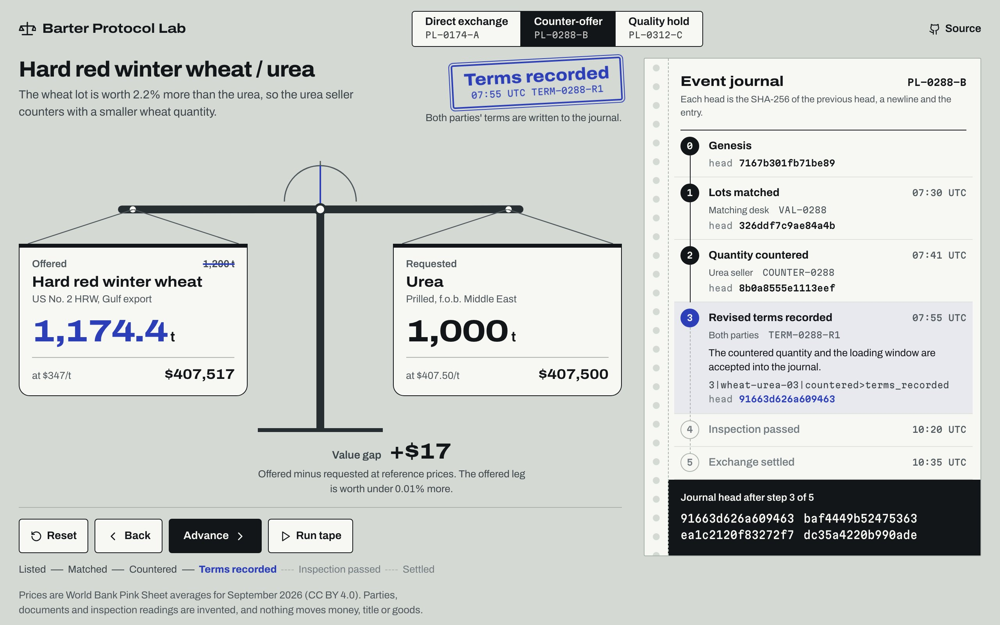

# Barter Protocol Lab

A state machine for commodity barter that replays three fixed trades in the browser. Each step updates the derived state, both leg quantities, the value gap at World Bank prices and a SHA-256 hash chain over the journal.

[](https://github.com/fortunexbt/barter/actions/workflows/ci.yml)



## Try it

Open the [live lab](https://fortunexbt.github.io/barter/), pick a scenario and press Advance. Copper for coffee settles, wheat for urea is countered down to 1,174.4 t of wheat before it settles, and cocoa for rice fails a moisture retest and is cancelled. The beam leans 3.5° for every 1% of value gap, up to 8°.

To run it locally you need Node.js 20 or later.

```bash
npm install
npm run dev
```

Then open http://localhost:5000/lab. It needs no `.env`, database or sign-in. `npm run verify` runs the typecheck, the engine tests and the production build, which is what CI runs after a production dependency audit.

## What's real

The prices are real and the trades aren't. Each leg is valued at the World Bank Pink Sheet monthly average for September 2026, so 1,200 t of US HRW wheat at $347/t is worth $8,900 more than 1,000 t of urea at $407.50/t. The parties, timestamps, evidence references and inspection readings are invented. Nothing moves money, title or goods, and the lab makes no network calls.

The rules live in `transitions` in [`demo-engine.ts`](client/src/features/protocol-lab/demo-engine.ts), written separately from the fixtures.

| From | Allowed next states |
| --- | --- |
| listed | matched, cancelled |
| matched | countered, terms recorded, cancelled |
| countered | countered, terms recorded, cancelled |
| terms recorded | inspection passed, inspection hold, cancelled |
| inspection hold | inspection passed, cancelled |
| inspection passed | settled |

Settled and cancelled accept nothing. The replay checks the whole journal before returning any step and throws on a move the table doesn't list, a wrong starting state, an out-of-order sequence number, or a quantity change outside a counter-offer. Stepping back past the counter-offer restores the listed quantity.

## Checking the hashes

The first head hashes the genesis entry (folio, start state, both legs, price period). Each later head hashes the previous head, a newline and the event entry. You can reproduce the first two heads of the copper trade with `shasum`.

```bash
printf '%s' 'PL-0174-A|listed|offered=copper:18|requested=coffee-arabica:35.9|prices=pink-sheet:2026-09' | shasum -a 256
# 94684eecc27612b0cee840ae503c3924480928abe8a68d8e49f09f4b47035fac
printf '%s\n%s' 94684eecc27612b0cee840ae503c3924480928abe8a68d8e49f09f4b47035fac '1|copper-coffee-01|listed>matched' | shasum -a 256
# 01e8f4e46d8928a44a7b32b7b68caa195e2891caa0ed051e12d96ec5cde58d28
```

The tests in [`demo-engine.test.ts`](client/src/features/protocol-lab/demo-engine.test.ts) check the browser SHA-256 against the FIPS 180-4 vectors and `node:crypto`, pin the final head of each journal, replay every legal path through the table and reject the illegal moves listed above.

## Price data

[`pink-sheet.json`](client/src/features/protocol-lab/pink-sheet.json) holds the six series used, with the workbook URL, its SHA-256, its update date (2 October 2026) and each series' World Bank description. `npm run data:prices -- <workbook URL>` rebuilds it from a newer month, and the tests then show which values and pinned hashes moved. These are monthly benchmark averages, not prices for a delivered lot.

Source data is the [World Bank Commodity Price Data (The Pink Sheet)](https://www.worldbank.org/en/research/commodity-markets), licensed [CC BY 4.0](https://datacatalog.worldbank.org/public-licenses#cc-by). The workbook credits its series to Bloomberg, the ICO, ICCO, USDA and others.

## Legacy prototype

Routes outside the lab open an older marketplace prototype with session sign-in, in-memory storage by default and optional Postgres (set `DATABASE_URL` and `SESSION_SECRET`, see `.env.example`). It's for exploring screens only. It isn't a live marketplace and hasn't been audited for custody or compliance, so don't give it real identity documents or funds.

## Licence

MIT, see [LICENSE](LICENSE). The Archivo and Martian Mono fonts are under the SIL Open Font License, see [`client/src/assets/fonts`](client/src/assets/fonts/LICENSE.md).
