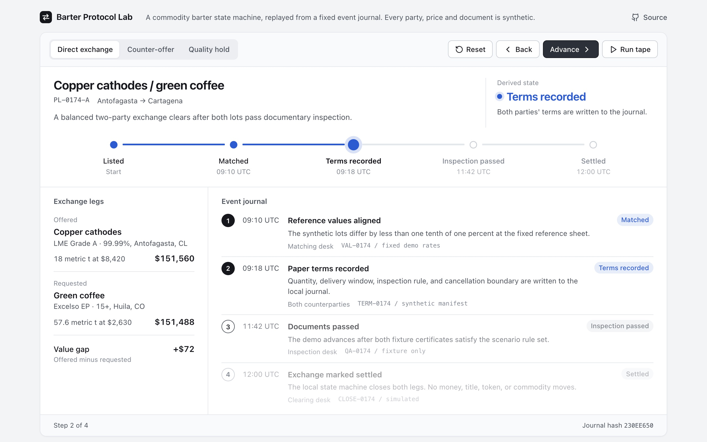

# Barter Protocol Lab

A commodity barter state machine with an explicit transition table, a SHA-256 hash-chained event journal and leg values priced from the World Bank Pink Sheet. Three fixed journals replay in the browser with no accounts, secrets, database or network calls.

[](https://github.com/fortunexbt/barter/actions/workflows/ci.yml)


[**Open the live protocol lab ↗**](https://fortunexbt.github.io/barter/)



The lab route is **`/lab`**. Pick a scenario and step the journal forward or back. The derived state, leg quantities, value gap and journal hash all come from the same replay.

## What you can replay

| Folio | Exchange | State path | Outcome |
| --- | --- | --- | --- |
| PL-0174-A | 18 t copper cathodes for 35.9 t Arabica coffee | matched, terms recorded, inspection passed | settled |
| PL-0288-B | 1,200 t US HRW wheat for 1,000 t urea | matched, countered to 1,174.4 t, terms recorded, inspection passed | settled |
| PL-0312-C | 40 t cocoa beans for 491.3 t Thai 5% rice | matched, terms recorded, inspection hold | cancelled |

Prices are real and the trades are not. Each leg is valued at the World Bank's September 2026 monthly average for its commodity (see [Data sources](#data-sources)). The parties, timestamps, evidence references and inspection readings are invented, and the page says so. Replaying the same scenario at the same step always produces the same snapshot. Nothing moves money, title or goods.

## Transition rules

`transitions` in `demo-engine.ts` lists every legal move. It is written out separately from the fixtures, and the tests check the fixtures against it.

| From | Allowed next states |
| --- | --- |
| listed | matched, cancelled |
| matched | countered, terms recorded, cancelled |
| countered | countered, terms recorded, cancelled |
| terms recorded | inspection passed, inspection hold, cancelled |
| inspection hold | inspection passed, cancelled |
| inspection passed | settled |
| settled, cancelled | none (terminal) |

The replay validates the whole journal before it returns any step, and throws a `ProtocolRuleError` when an event

- skips a state or makes a move the table doesn't list (listed to settled, terms recorded to settled, hold to settled),
- starts from a state other than the current one,
- carries a sequence number out of order, or
- amends a leg anywhere other than a counter-offer, or to a quantity that isn't positive.

Amendments are applied from the journal, so stepping back past the counter-offer restores the listed quantity.

## Journal hash

The journal head is a SHA-256 chain you can recompute with `shasum`. The first head hashes the genesis entry (folio, start state, both legs and the price period). Each event then hashes the previous head, a newline and the event entry `sequence|id|from>to`, plus `|leg=quantity` for an amendment.

```bash
$ printf '%s' 'PL-0174-A|listed|offered=copper:18|requested=coffee-arabica:35.9|prices=pink-sheet:2026-09' | shasum -a 256
94684eecc27612b0cee840ae503c3924480928abe8a68d8e49f09f4b47035fac  -
$ printf '%s\n%s' 94684eecc27612b0cee840ae503c3924480928abe8a68d8e49f09f4b47035fac '1|copper-coffee-01|listed>matched' | shasum -a 256
01e8f4e46d8928a44a7b32b7b68caa195e2891caa0ed051e12d96ec5cde58d28  -
```

The page shows the first 12 characters of the head for the current step. The SHA-256 implementation is checked against the FIPS 180-4 vectors and `node:crypto`, and the final head of each journal is pinned in the tests.

## Data sources

| Leg | Pink Sheet series | Sep 2026 average |
| --- | --- | --- |
| Copper cathodes | Copper (LME), grade A, settlement price | $14,474/t |
| Arabica coffee | Coffee, Arabica (ICO indicator, other milds) | $7.26/kg |
| Cocoa beans | Cocoa (ICCO daily price) | $5.92/kg |
| US HRW wheat | Wheat, US HRW, Gulf export | $347/t |
| Urea | Urea, prill spot f.o.b. Middle East | $407.50/t |
| Thai white rice | Rice, Thai 5% broken, f.o.b. Bangkok | $482/t |

Source: [World Bank Commodity Price Data (The Pink Sheet)](https://www.worldbank.org/en/research/commodity-markets), monthly prices workbook updated 2 October 2026. Licensed [CC BY 4.0](https://datacatalog.worldbank.org/public-licenses#cc-by), the World Bank's default licence for its open data. The workbook credits its underlying series to Bloomberg, the ICO, ICCO, USDA and others.

`client/src/features/protocol-lab/pink-sheet.json` holds the extract with the workbook URL, its SHA-256, the update date and each series' full World Bank description. To move to a newer month, run

```bash
npm run data:prices -- <CMO-Historical-Data-Monthly.xlsx URL>
```

The script downloads the workbook, reads it with Node built-ins only and rewrites the JSON. The tests then show which balances and pinned hashes changed. These are monthly benchmark averages, not delivered prices for a specific lot.

## Run it

Requirements: Node.js 20+ and npm.

```bash
npm install
npm run dev
```

Open [http://localhost:5000/lab](http://localhost:5000/lab). No `.env`, sign-in, Postgres instance, wallet, or API key is needed.

To exercise the complete quality gate:

```bash
npm run verify
```

That command runs TypeScript checking, the engine tests and the production build.

## Capability ledger

The repository began as a broad marketplace prototype. This revival keeps that surface available for exploration while drawing a hard line between working software and product concepts.

| Status | Included |
| --- | --- |
| Implemented | Public protocol lab, deterministic reducer, three replay fixtures, event journal, responsive UI, session authentication, in-memory development storage, optional Postgres adapter |
| Real data | Commodity reference prices (World Bank Pink Sheet, September 2026) |
| Simulated | Counterparties, matching, inspection evidence, agreement records, escrow states, identity checks, settlement receipts |
| Roadmap | Live market data, regulated identity provider, inspection network, custody or payment rails, legal title transfer, blockchain anchoring, production matching engine |

The authenticated `/auth` workspace is explicitly marked **legacy prototype**. It is useful for exploring screens and data flows, but it is not a live marketplace and must not receive real identity documents, funds, wallet keys, or commercially sensitive data.

## Architecture

```text
/lab UI ──> fixed scenario fixtures ──> pure replay reducer ──> snapshot + event tape

legacy UI ──> Express REST API ──> in-memory adapter (default)
                              └──> PostgreSQL adapter (optional)
```

The lab sits outside the authentication provider and storage layer, so it runs as a static page and its claims can be tested on their own. The reducer enforces the transition table, clamps replay boundaries and derives the SHA-256 journal head from the applied events.

Key files:

- `client/src/features/protocol-lab/demo-engine.ts` holds the transition table, scenarios and replay
- `client/src/features/protocol-lab/demo-engine.test.ts` holds the rule, pricing and hash tests
- `client/src/features/protocol-lab/reference-prices.ts` and `pink-sheet.json` hold the World Bank extract
- `client/src/features/protocol-lab/sha256.ts` is a synchronous SHA-256 for the browser
- `scripts/extract-pink-sheet.ts` regenerates the extract from the World Bank workbook
- `client/src/pages/protocol-lab-page.tsx` is the public lab page
- `server/storage.ts` is the typed in-memory adapter and optional database selection
- `shared/schema.ts` is the shared domain model of the legacy app

## Optional database mode

Without `DATABASE_URL`, the server starts with deterministic in-memory fixtures. For persistent local development, copy `.env.example`, provide a PostgreSQL connection string, and run:

```bash
npm run db:push
npm run dev
```

A persistent production deployment must set a strong `SESSION_SECRET`. See `.env.example` for the supported variables.

## Security boundary

- Registration always creates a standard trader account; clients cannot assign themselves admin or verified status.
- Password hashes are excluded from authentication responses.
- Session cookies are HTTP-only, same-site, and secure in production.
- Identity screens accept only three named synthetic fixture IDs, with no file picker or free-text document intake, and the API rejects every other value.
- The legacy WebSocket endpoint fails closed until session-authenticated upgrades are implemented.
- Production dependencies are audited in CI; `npm audit --omit=dev` reports zero known vulnerabilities at this revision.
- The repository has not been audited for custody, compliance, or production commodity trading.

## Scripts

| Command | Purpose |
| --- | --- |
| `npm run dev` | Start Express and Vite on port 5000 |
| `npm run check` | Run the TypeScript compiler |
| `npm test` | Test transition rules, pricing and the journal hash |
| `npm run build` | Build browser and server bundles |
| `npm run build:pages` | Build the static GitHub Pages site into `dist/pages` with the `/barter/` base path |
| `npm run verify` | Run check, tests, and build |
| `npm run db:push` | Push the optional Drizzle schema |
| `npm run data:prices -- <url>` | Regenerate the World Bank price extract |

## License

MIT © 2026 FortuneXBT. See [LICENSE](LICENSE).
