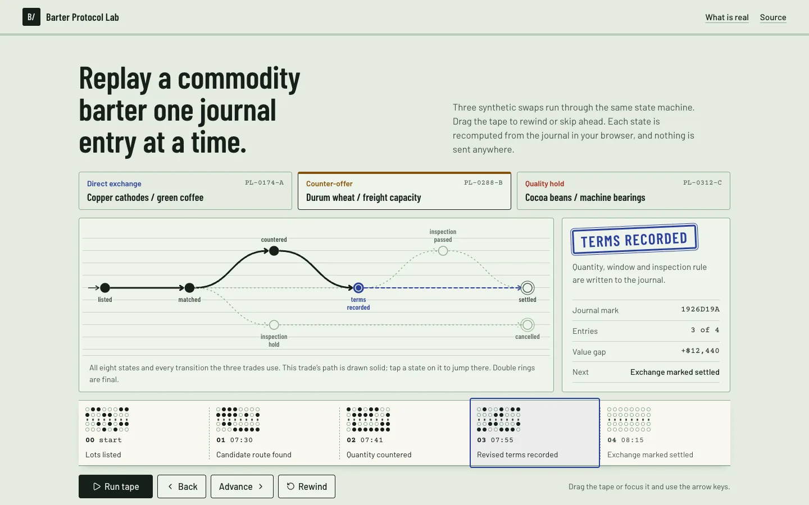

# Barter Protocol Lab

Replay a commodity barter one journal entry at a time. Three synthetic swaps run
through one state machine, and you can drag a punched event tape back and forth
to watch the state get recomputed from the journal.

**Live demo: [barter-sooty.vercel.app](https://barter-sooty.vercel.app)**

[](https://github.com/fortunexbt/barter/actions/workflows/ci.yml)



## What it does

| Folio | Trade | Path | Ends |
| --- | --- | --- | --- |
| PL-0174-A | Copper cathodes / green coffee | matched, terms, inspection passed | settled |
| PL-0288-B | Durum wheat / freight capacity | matched, countered, terms | settled |
| PL-0312-C | Cocoa beans / machine bearings | matched, inspection hold | cancelled |

- The state diagram shows all eight states and every transition the trades use.
  The selected trade's path is drawn solid, and you can click a state on it to
  jump there.
- The event tape has one frame per journal entry. Drag it, or focus it and use
  the arrow keys, Home and End. Each frame's holes spell the journal mark after
  that entry in binary, so rewinding un-punches them.
- The journal lists every entry with its actor, evidence and transition. The
  URL keeps the trade and step (`?scenario=wheat-freight&step=2`), so a replay
  position can be shared.

## How it works

`client/src/features/protocol-lab/demo-engine.ts` holds the three fixture
trades and `replayScenario(scenario, step)`. The function applies the first
`step` journal entries to the initial state, throws if an entry's `from` state
doesn't match the current state, clamps out-of-range steps, and hashes the
folio, state and applied entries (FNV-1a) into an 8-digit journal mark. The UI
never stores state. Every render calls the reducer again, which is why
scrubbing backwards is free.

It's a static Vite and React build with no server, no network calls and no
keys.

## Run locally

Node 20.19 or newer.

```bash
npm install
npm run dev        # http://localhost:4151
```

## Tests

```bash
npm test           # replay invariants: determinism, clamping, invalid transitions
npm run verify     # type check, tests, production build
```

## Limits of the demo

Counterparties, reference values, inspection readings and certificates are
fixed fixtures, not market data. There are no accounts, prices, payments,
custody, title transfer or chain anchoring. It models the protocol and is not
an exchange.

## License

MIT. See [LICENSE](LICENSE).
